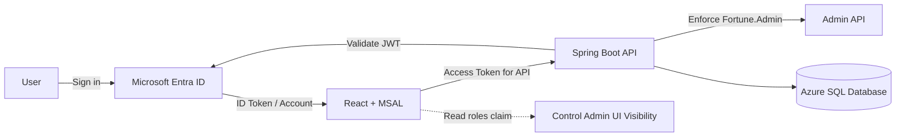
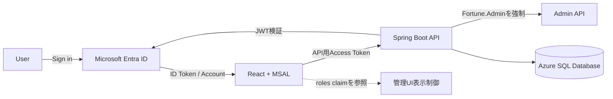

# Step 05: Microsoft Entra ID Authentication and Role-Based Authorization

> English translation of the Japanese document above.

## 1. Purpose of This Step

In this step, the React frontend calls the Spring Boot backend API with a Microsoft Entra ID access token, and administrative features are protected by the `Fortune.Admin` app role.

The completed implementation has the following capabilities:

- Users can sign in and sign out in React.
- MSAL can obtain an access token for the backend API.
- ****** to the standard API.
- Only users with `Fortune.Admin` can access `/api/admin/**`.
- The frontend administration UI is shown or hidden based on the presence of `Fortune.Admin`.
- Backend and frontend authentication and authorization behavior is covered by tests.

## 2. Authentication and Authorization Responsibilities



### Authentication

Authentication confirms who the user is.

- React signs the user in with MSAL.
- React obtains an access token by specifying the backend API scope.
- Spring Security validates the access token's signature, issuer, audience, and other properties.

### Authorization

Authorization determines what the user is allowed to do.

- The backend checks whether the access token's `roles` claim contains `Fortune.Admin`.
- The frontend reads the same access token claim to determine whether the administration UI should be displayed.
- Frontend visibility control must not be treated as the security boundary. The backend must always make the final authorization decision and deny unauthorized requests.

## 3. Why Use the Access Token Instead of the ID Token?

Initially, the administration UI was controlled by using `account.idTokenClaims.roles` in React. However, `Fortune.Admin` is defined as an app role for the backend API, and the role that was verified appeared in the access token issued for the backend API.

```json
{
  "scp": "access_as_user",
  "roles": [
    "Fortune.Admin"
  ]
}
```

Because `Fortune.Admin` may not be present in the ID token for the React client, checking only that token can result in `isFortuneAdmin = false` even for an administrator. The implementation was therefore standardized on the following approach:

```text
Access Token for Backend API
        │
        ├─ Backend: Spring Security validates roles and protects the Admin API
        └─ Frontend: Reads roles to show or hide the Admin UI
```

Parsing the JWT payload in the frontend is not a substitute for signature validation. The frontend reads claims only as a hint for UI visibility; the backend is responsible for verifying the token's authenticity and enforcing permissions.

## 4. Microsoft Entra ID Configuration

Configure environment-specific values to match the actual app registrations, and do not commit values or secrets to Git.

1. Expose an API scope, such as `access_as_user`, in the backend API app registration.
2. Define the `Fortune.Admin` app role for the backend API.
3. Add the backend API delegated permission to the React client and grant the required consent.
4. Assign `Fortune.Admin` to the administrator or target group.
5. Confirm that the actual access token for the backend API contains the expected `aud`, `scp`, and `roles` claims.

> Instead of duplicating the app role in the React client to make the UI appear, read `Fortune.Admin`, which is defined as an API permission, from the access token issued for the backend API.

## 5. Backend Implementation

### 5.1 Files Changed

```text
backend/src/main/java/com/example/backend/SecurityConfiguration.java
backend/src/test/java/com/example/backend/FortuneManagementControllerSecurityTest.java
```

### 5.2 SecurityConfiguration

The configuration has the following responsibilities:

- Validate JWTs as an OAuth 2.0 resource server.
- Convert the JWT `roles` claim into Spring Security authorities.
- Allow authenticated users to access standard APIs.
- Allow only users with `Fortune.Admin` to access `/api/admin/**`.
- Configure the CORS settings required for calls from the browser frontend.
- Explicitly define the CSRF policy for the token-based API.

The conceptual authorization rules are as follows:

```text
/api/admin/**  -> Fortune.Admin required
Other APIs     -> Authentication required
```

Whether authorities use the `ROLE_` prefix or the literal value `Fortune.Admin`, the JWT converter and request matcher must use the same convention.

### 5.3 Backend Security Tests

At a minimum, `FortuneManagementControllerSecurityTest.java` covers the following combinations:

| Condition | GET | POST | DELETE |
|---|---:|---:|---:|
| Unauthenticated | Denied | Denied | Denied |
| Authenticated without the role | `403` | `403` | `403` |
| With `Fortune.Admin` | Allowed | Allowed | Allowed |

It is important to test authentication and authorization through the Spring Security filter chain, not only the controller's successful paths.

## 6. Frontend Implementation

### 6.1 Files Changed

```text
frontend/package.json
frontend/package-lock.json
frontend/src/authConfig.ts
frontend/src/main.tsx
frontend/src/App.tsx
frontend/src/App.test.tsx
frontend/src/FortuneManagement.tsx
frontend/src/FortuneManagement.test.tsx
```

### 6.2 MSAL Configuration

`authConfig.ts` centralizes the settings required for the React client and backend API calls:

- Client ID
- Authority / tenant
- Redirect URI
- Backend API scope
- Login request
- Token request

`main.tsx` initializes MSAL and places the React application under the MSAL provider.

When specifying environment-specific values, use the environment-variable mechanism or secure configuration-injection method adopted by the project.

### 6.3 Obtaining an Access Token

`App.tsx` obtains an access token for the backend API by specifying the signed-in account.

```text
Sign in
  -> Obtain account
  -> acquireTokenSilent()
  -> Access Token for Backend API
  -> Authorization: ******
```

If token acquisition fails, the application uses a fail-closed initial state and treats the user as unauthorized.

### 6.4 Reading Roles from the Access Token

In `App.tsx`, the JWT payload in the access token is decoded as Base64URL.

```typescript
type AccessTokenClaims = {
    roles?: string[]
}

function parseAccessTokenClaims(
    accessToken: string
): AccessTokenClaims {
    const payload = accessToken.split('.')[1]

    if (!payload) {
        return {}
    }

    const base64 = payload
        .replace(/-/g, '+')
        .replace(/_/g, '/')

    const paddedBase64 =
        base64 + '='.repeat((4 - base64.length % 4) % 4)

    return JSON.parse(
        atob(paddedBase64)
    ) as AccessTokenClaims
}
```

JWTs use Base64URL rather than standard Base64, so the implementation converts `-` and `_` and restores the required padding.

After obtaining the access token, the application checks the role:

```typescript
const [isFortuneAdmin, setIsFortuneAdmin] = useState(false)

useEffect(() => {
    if (!account) {
        setIsFortuneAdmin(false)
        return
    }

    const loadAuthorization = async () => {
        try {
            const accessToken = await getAccessToken()

            if (!accessToken) {
                setIsFortuneAdmin(false)
                return
            }

            const claims = parseAccessTokenClaims(accessToken)

            setIsFortuneAdmin(
                claims.roles?.includes('Fortune.Admin') ?? false
            )
        } catch (error) {
            console.error(
                'Failed to determine authorization.',
                error
            )
            setIsFortuneAdmin(false)
        }
    }

    void loadAuthorization()
}, [account])
```

The administration screen is displayed only when `isFortuneAdmin` is true.

```tsx
{isFortuneAdmin && (
    <FortuneManagement
        apiBaseUrl={apiBaseUrl}
        getAccessToken={getAccessToken}
    />
)}
```

### 6.5 Calling the Admin API

Each GET, POST, and DELETE operation in `FortuneManagement.tsx` obtains an access token for the backend API and adds the following header:

```http
Authorization: ******
```

Hiding the UI does not prevent direct API calls, so the backend's `Fortune.Admin` check must never be omitted.

## 7. Frontend Tests

### 7.1 JWT Generation Helper

The tests generate an unsigned JWT string whose roles can be changed for each scenario.

```typescript
function createTestAccessToken(roles?: string[]) {
    const header = {
        alg: 'none',
        typ: 'JWT',
    }

    const payload = roles ? { roles } : {}

    const encode = (value: object) =>
        btoa(JSON.stringify(value))
            .replace(/\+/g, '-')
            .replace(/\//g, '_')
            .replace(/=+$/, '')

    return `${encode(header)}.${encode(payload)}.test-signature`
}
```

This helper is used only to test payload parsing. It does not emulate real token issuance or signature validation.

### 7.2 Mocking acquireTokenSilent

```typescript
let accessToken = createTestAccessToken()

const acquireTokenSilent = vi.fn(
    async () => ({
        accessToken,
    })
)
```

Each test changes the value of `accessToken` as needed.

### 7.3 Administrator

The test uses `findByText` to wait until the asynchronous `useEffect` authorization check has completed and the UI appears.

```typescript
it('displays Fortune Management for a Fortune.Admin user', async () => {
    accessToken = createTestAccessToken([
        'Fortune.Admin',
    ])

    render(<App />)

    expect(
        await screen.findByText('Fortune Management')
    ).toBeInTheDocument()
})
```

### 7.4 Standard User

The test verifies that the administration UI remains absent after access-token acquisition has completed, rather than checking only immediately after rendering.

```typescript
it('does not display Fortune Management for a non-admin user', async () => {
    accessToken = createTestAccessToken()

    render(<App />)

    await vi.waitFor(() => {
        expect(acquireTokenSilent).toHaveBeenCalled()
    })

    expect(
        screen.queryByText('Fortune Management')
    ).not.toBeInTheDocument()
})
```

### 7.5 Expected API Call

Because an access token is generated for each test, the expected value also uses ****** `accessToken`.

```typescript
expect(fetchMock).toHaveBeenCalledWith(
    'http://localhost:8080/api/fortune',
    {
        headers: {
            Authorization: `******
        },
    }
)
```

## 8. Tests and Manual Verification

### 8.1 Frontend

Run the following commands in the `frontend` directory:

```powershell
npx vitest run src/App.test.tsx
npm test
npm run build
```

Verified results:

```text
App.test.tsx                 4 passed
FortuneManagement.test.tsx   2 passed
------------------------------------
Frontend total               6 passed

npm run build                success
```

### 8.2 Application UI

| Item | Standard User | `Fortune.Admin` |
|---|---:|---:|
| Sign in | Successful | Successful |
| Get Fortune | Successful | Successful |
| Fortune Management | Hidden | Displayed |
| Admin API GET / POST / DELETE | `403` | Successful |

The application UI was manually verified to display Fortune Management only when the user has administrator privileges.

## 9. Troubleshooting

### 9.1 The Administration Screen Is Not Displayed for an Administrator

Check the following, in order:

1. Confirm that React is reading the access token for the backend API rather than the ID token.
2. Confirm that the access token's `aud` targets the backend API.
3. Confirm that `scp` contains the required scope.
4. Confirm that `roles` contains `Fortune.Admin`.
5. Confirm that the app-role assignment applies to the user who is actually signed in.
6. Confirm that an old token is not still being used after the role assignment was changed.

### 9.2 The Vitest Worker Does Not Start

Observed error:

```text
Failed to start threads worker
Timeout waiting for worker to respond
Test Files  no tests
```

This is not a failed test assertion. It is a worker startup failure that occurs before tests begin. If it happens again, first check whether it is reproducible with the normal command, and then use the following commands to isolate the issue:

```powershell
npx vitest run src/App.test.tsx --no-file-parallelism
npx vitest run src/App.test.tsx --no-file-parallelism --no-isolate
```

Do not ignore the issue merely because one retry succeeds. If it continues to recur, investigate the Vitest worker configuration and the execution environment.

### 9.3 Temporary Azure SQL Database Unavailability

Observed error:

```text
Database 'fortune' ... is not currently available.
Please retry the connection later.
```

This is a resiliency concern separate from authentication and authorization. Consider the following in a future step:

- Short retries and backoff while establishing a connection
- Connection timeout
- HikariCP configuration
- Retry safety for POST and DELETE operations
- Transaction boundaries
- Traces and metrics for retries and connection failures

Blindly retrying write operations can cause duplicate updates, so take operation idempotency and completion state into account.

### 9.4 Frontend Build Chunk Warning

The build succeeded, but it reported a warning that a minified chunk exceeded 500 kB. Consider dynamic imports or code splitting when needed. This warning is separate from the authentication and authorization completion criteria.

## 10. Commits

The backend and frontend changes were committed separately.

```text
dffe75d feat: add role-based authorization for admin APIs
be2ad9c feat: add MSAL authentication and role-based UI authorization
```

Changes included:

```text
dffe75d
- Protect /api/admin/** with Fortune.Admin
- Convert JWT roles to authorities
- Configure CORS / CSRF
- Add Admin API security tests

be2ad9c
- React + MSAL
- Sign in / Sign out
- Obtain an access token for the backend API
- ******
- Control Admin UI visibility with Fortune.Admin in the access token
- Add frontend tests
```

After the commits, `git status` was verified to report:

```text
nothing to commit, working tree clean
```

## 11. Completion Criteria

- [x] An access token for the backend API can be obtained.
- [x] ****** to the standard API.
- [x] `/api/admin/**` is protected with `Fortune.Admin`.
- [x] The administration UI can be shown or hidden based on the role in the access token.
- [x] A standard user's direct call to the Admin API is denied.
- [x] Backend authentication and authorization tests pass.
- [x] All six frontend tests pass.
- [x] The frontend build succeeds.
- [x] The application UI has been verified with both a standard user and an administrator.
- [x] Backend and frontend changes are committed separately.

## 12. Next Steps

1. Design retry behavior for transient Azure SQL Database connection failures.
2. Tune HikariCP and the connection timeout.
3. Design idempotency and transaction handling for POST and DELETE retries.
4. Improve observability for authentication failures, authorization denials, and database connection failures by using OpenTelemetry or a similar tool.
5. Add code splitting to the frontend bundle.
6. Investigate the execution environment if the Vitest worker timeout continues to recur.

---

# Step 05: Microsoft Entra ID認証とロールベース認可

## 1. このStepの目的

このStepでは、React FrontendからSpring Boot Backend APIをMicrosoft Entra IDのAccess Tokenで呼び出し、`Fortune.Admin` App Roleによって管理機能を保護します。

完成時の状態は次のとおりです。

- ReactでSign in / Sign outできる。
- MSALでBackend API向けAccess Tokenを取得できる。
- 通常APIへBearer Tokenを付けてアクセスできる。
- `/api/admin/**` は `Fortune.Admin` を持つユーザーだけ利用できる。
- Frontendの管理UIも `Fortune.Admin` の有無に応じて表示・非表示になる。
- BackendとFrontendの認証・認可をテストで固定できる。

## 2. 認証と認可の責務



### Authentication

Authenticationは「誰であるか」を確認します。

- ReactはMSALでサインインする。
- ReactはBackend APIのscopeを指定してAccess Tokenを取得する。
- Spring SecurityはAccess Tokenの署名、issuer、audienceなどを検証する。

### Authorization

Authorizationは「何をしてよいか」を確認します。

- BackendはAccess Tokenの `roles` claimに `Fortune.Admin` があるか確認する。
- Frontendも同じAccess Tokenのclaimを読み、管理UIの表示可否を決める。
- Frontendの表示制御だけをSecurity境界にしてはいけない。最終的な拒否は常にBackendで行う。

## 3. なぜID TokenではなくAccess Tokenを見るのか

当初は、Reactの `account.idTokenClaims.roles` を使って管理UIを判定しました。しかし、`Fortune.Admin` はBackend APIに対するApp Roleとして定義されており、確認できたRoleはBackend API向けAccess Tokenに含まれていました。

```json
{
  "scp": "access_as_user",
  "roles": [
    "Fortune.Admin"
  ]
}
```

Reactクライアント用ID Tokenだけを見ても `Fortune.Admin` が存在しないため、管理ユーザーでも `isFortuneAdmin = false` になり得ます。そのため、次の方針へ統一しました。

```text
Backend API用Access Token
        │
        ├─ Backend: Spring Securityがrolesを検証して管理APIを保護
        └─ Frontend: rolesを参照して管理UIを表示・非表示
```

FrontendでのJWT payload解析は、署名検証の代替ではありません。Frontendは表示制御の参考としてclaimを読むだけで、Tokenの真正性確認と権限強制はBackendが担当します。

## 4. Microsoft Entra ID側の準備

環境固有値は実際のApp Registrationに合わせて設定し、値やシークレットをGitへコミットしないでください。

1. Backend APIのApp RegistrationでAPI scope（例: `access_as_user`）を公開する。
2. Backend API側に `Fortune.Admin` App Roleを定義する。
3. ReactクライアントへBackend APIのdelegated permissionを追加し、必要なconsentを行う。
4. 管理ユーザーまたは対象グループへ `Fortune.Admin` を割り当てる。
5. 実際のBackend API向けAccess Tokenに、期待する `aud`、`scp`、`roles` が含まれることを確認する。

> App RoleをReactクライアント側へ重複定義してUI表示を成立させるのではなく、APIの権限として定義した `Fortune.Admin` をBackend API向けAccess Tokenから参照します。

## 5. Backendの実装

### 5.1 変更対象

```text
backend/src/main/java/com/example/backend/SecurityConfiguration.java
backend/src/test/java/com/example/backend/FortuneManagementControllerSecurityTest.java
```

### 5.2 SecurityConfiguration

設定する責務は次のとおりです。

- OAuth 2.0 Resource ServerとしてJWTを検証する。
- JWTの `roles` claimをSpring SecurityのAuthorityへ変換する。
- 通常APIは認証済みユーザーに許可する。
- `/api/admin/**` は `Fortune.Admin` を持つユーザーだけに許可する。
- Browser Frontendからの呼び出しに必要なCORSを構成する。
- TokenベースのAPIとしてCSRF方針を明示する。

概念的な認可ルールは次のとおりです。

```text
/api/admin/**  -> Fortune.Admin必須
その他のAPI    -> 認証必須
```

Authority名へ `ROLE_` prefixを付けるか、そのまま `Fortune.Admin` を使うかは、JWT converterとrequest matcherで必ず一致させます。

### 5.3 Backend Securityテスト

`FortuneManagementControllerSecurityTest.java` では、少なくとも次の組み合わせを固定します。

| 条件 | GET | POST | DELETE |
|---|---:|---:|---:|
| 未認証 | 拒否 | 拒否 | 拒否 |
| 認証済み・Roleなし | `403` | `403` | `403` |
| `Fortune.Admin` あり | 許可 | 許可 | 許可 |

Controllerの正常系だけでなく、Spring Security filter chainを通した認証・認可結果を検証することが重要です。

## 6. Frontendの実装

### 6.1 変更対象

```text
frontend/package.json
frontend/package-lock.json
frontend/src/authConfig.ts
frontend/src/main.tsx
frontend/src/App.tsx
frontend/src/App.test.tsx
frontend/src/FortuneManagement.tsx
frontend/src/FortuneManagement.test.tsx
```

### 6.2 MSAL設定

`authConfig.ts` に、ReactクライアントとBackend API呼び出しに必要な設定をまとめます。

- Client ID
- Authority / Tenant
- Redirect URI
- Backend API scope
- Login request
- Token request

`main.tsx` でMSALを初期化し、ReactアプリをMSAL Provider配下へ配置します。

環境固有値を記載する場合は、プロジェクトで採用している環境変数または安全な設定注入方法を使用してください。

### 6.3 Access Token取得

`App.tsx` は、サインイン済みaccountを指定してBackend API用Access Tokenを取得します。

```text
Sign in
  -> account取得
  -> acquireTokenSilent()
  -> Backend API用Access Token
  -> Authorization: Bearer <token>
```

Token取得に失敗した場合は、未認可を安全側の初期値として扱います。

### 6.4 Access Tokenのrolesを読む

`App.tsx` ではAccess TokenのJWT payloadをBase64URLとしてデコードします。

```typescript
type AccessTokenClaims = {
    roles?: string[]
}

function parseAccessTokenClaims(
    accessToken: string
): AccessTokenClaims {
    const payload = accessToken.split('.')[1]

    if (!payload) {
        return {}
    }

    const base64 = payload
        .replace(/-/g, '+')
        .replace(/_/g, '/')

    const paddedBase64 =
        base64 + '='.repeat((4 - base64.length % 4) % 4)

    return JSON.parse(
        atob(paddedBase64)
    ) as AccessTokenClaims
}
```

JWTは通常のBase64ではなくBase64URLなので、`-` / `_` の変換とpadding補完を行います。

次に、Access Token取得後にRoleを判定します。

```typescript
const [isFortuneAdmin, setIsFortuneAdmin] = useState(false)

useEffect(() => {
    if (!account) {
        setIsFortuneAdmin(false)
        return
    }

    const loadAuthorization = async () => {
        try {
            const accessToken = await getAccessToken()

            if (!accessToken) {
                setIsFortuneAdmin(false)
                return
            }

            const claims = parseAccessTokenClaims(accessToken)

            setIsFortuneAdmin(
                claims.roles?.includes('Fortune.Admin') ?? false
            )
        } catch (error) {
            console.error(
                'Failed to determine authorization.',
                error
            )
            setIsFortuneAdmin(false)
        }
    }

    void loadAuthorization()
}, [account])
```

管理画面は `isFortuneAdmin` がtrueの場合だけ表示します。

```tsx
{isFortuneAdmin && (
    <FortuneManagement
        apiBaseUrl={apiBaseUrl}
        getAccessToken={getAccessToken}
    />
)}
```

### 6.5 管理API呼び出し

`FortuneManagement.tsx` のGET / POST / DELETEでは、毎回Backend API用Access Tokenを取得し、次のheaderを付けます。

```http
Authorization: Bearer <access-token>
```

UIを非表示にしてもAPIは直接呼べるため、Backendの `Fortune.Admin` チェックを省略してはいけません。

## 7. Frontendテスト

### 7.1 JWT生成ヘルパー

テストでは、Roleの有無を切り替えられる署名なしのJWT文字列を生成します。

```typescript
function createTestAccessToken(roles?: string[]) {
    const header = {
        alg: 'none',
        typ: 'JWT',
    }

    const payload = roles ? { roles } : {}

    const encode = (value: object) =>
        btoa(JSON.stringify(value))
            .replace(/\+/g, '-')
            .replace(/\//g, '_')
            .replace(/=+$/, '')

    return `${encode(header)}.${encode(payload)}.test-signature`
}
```

これはpayload解析のテスト専用であり、実際のToken発行や署名検証を模倣するものではありません。

### 7.2 acquireTokenSilentのモック

```typescript
let accessToken = createTestAccessToken()

const acquireTokenSilent = vi.fn(
    async () => ({
        accessToken,
    })
)
```

各テストで `accessToken` を切り替えます。

### 7.3 管理ユーザー

`useEffect` による非同期判定後の表示を待つため、`findByText` を使います。

```typescript
it('displays Fortune Management for a Fortune.Admin user', async () => {
    accessToken = createTestAccessToken([
        'Fortune.Admin',
    ])

    render(<App />)

    expect(
        await screen.findByText('Fortune Management')
    ).toBeInTheDocument()
})
```

### 7.4 一般ユーザー

render直後ではなく、Access Token取得完了後も管理UIがないことを検証します。

```typescript
it('does not display Fortune Management for a non-admin user', async () => {
    accessToken = createTestAccessToken()

    render(<App />)

    await vi.waitFor(() => {
        expect(acquireTokenSilent).toHaveBeenCalled()
    })

    expect(
        screen.queryByText('Fortune Management')
    ).not.toBeInTheDocument()
})
```

### 7.5 API呼び出しの期待値

Access Tokenをテストごとに生成するよう変更したため、Bearer headerの期待値も固定文字列ではなく、そのテストの `accessToken` を使います。

```typescript
expect(fetchMock).toHaveBeenCalledWith(
    'http://localhost:8080/api/fortune',
    {
        headers: {
            Authorization: `Bearer ${accessToken}`,
        },
    }
)
```

## 8. テストと動作確認

### 8.1 Frontend

`frontend` ディレクトリで実行します。

```powershell
npx vitest run src/App.test.tsx
npm test
npm run build
```

確認済み結果:

```text
App.test.tsx                 4 passed
FortuneManagement.test.tsx   2 passed
------------------------------------
Frontend全体                 6 passed

npm run build                success
```

### 8.2 実画面

| 確認項目 | 一般ユーザー | `Fortune.Admin` |
|---|---:|---:|
| Sign in | 成功 | 成功 |
| Fortune取得 | 成功 | 成功 |
| Fortune Management | 非表示 | 表示 |
| 管理API GET / POST / DELETE | `403` | 成功 |

管理者権限の場合だけFortune管理画面が表示されることを実画面で確認しました。

## 9. トラブルシューティング

### 9.1 管理者なのに管理画面が表示されない

次の順序で確認します。

1. ReactがID TokenではなくBackend API向けAccess Tokenを参照しているか。
2. Access Tokenの `aud` がBackend API向けになっているか。
3. `scp` に必要なscopeがあるか。
4. `roles` に `Fortune.Admin` があるか。
5. App Roleの割り当て対象と、実際にサインインしているユーザーが一致しているか。
6. Role割り当て変更後に、古いTokenを使い続けていないか。

### 9.2 Vitest workerが起動しない

確認されたエラー:

```text
Failed to start threads worker
Timeout waiting for worker to respond
Test Files  no tests
```

これはテストassertionの失敗ではなく、テスト開始前のworker起動失敗です。再発時は、通常実行で再現性を確認した後、次を切り分けに使用します。

```powershell
npx vitest run src/App.test.tsx --no-file-parallelism
npx vitest run src/App.test.tsx --no-file-parallelism --no-isolate
```

一度の再実行で通ったことだけを理由に問題を無視せず、継続的に再発する場合はVitestのworker設定や実行環境を調査します。

### 9.3 Azure SQL Databaseの一時的な接続不能

確認されたエラー:

```text
Database 'fortune' ... is not currently available.
Please retry the connection later.
```

これは認証・認可とは別のResiliency課題です。今後、次を検討します。

- 接続確立時の短いretryとbackoff
- connection timeout
- HikariCP設定
- POST / DELETEの再試行安全性
- トランザクション境界
- Retryや接続障害のtrace / metrics

更新系操作を盲目的に再実行すると二重更新の可能性があるため、処理の冪等性と完了状態を考慮します。

### 9.4 Frontend buildのchunk警告

buildは成功していますが、minified chunkが500 kBを超える警告が出ました。必要になった時点でdynamic importやcode splittingを検討します。認証・認可の完了条件とは分離します。

## 10. コミット

BackendとFrontendを分けてコミットしました。

```text
dffe75d feat: add role-based authorization for admin APIs
be2ad9c feat: add MSAL authentication and role-based UI authorization
```

変更内容:

```text
dffe75d
- Fortune.Adminによる /api/admin/** の保護
- JWT RoleからAuthorityへの変換
- CORS / CSRF設定
- 管理API Securityテスト

be2ad9c
- React + MSAL
- Sign in / Sign out
- Backend API用Access Token取得
- Bearer TokenでのAPI呼び出し
- Access TokenのFortune.Adminによる管理UI制御
- Frontendテスト
```

コミット後に `git status` が次の状態であることを確認済みです。

```text
nothing to commit, working tree clean
```

## 11. 完了条件

- [x] Backend API向けAccess Tokenを取得できる。
- [x] 通常APIへBearer Tokenを送信できる。
- [x] `/api/admin/**` を `Fortune.Admin` で保護できる。
- [x] Access TokenのRoleで管理UIを表示・非表示にできる。
- [x] 一般ユーザーが管理APIを直接呼ぶと拒否される。
- [x] Backendの認証・認可テストが成功する。
- [x] Frontend 6 testsが成功する。
- [x] Frontend buildが成功する。
- [x] 一般ユーザーと管理ユーザーで実画面を確認する。
- [x] Backend / Frontendを分けてコミットする。

## 12. 次の課題

1. Azure SQL DatabaseのTransient connection failureへのretry設計
2. HikariCPとconnection timeoutの調整
3. POST / DELETE再試行時の冪等性とトランザクション設計
4. OpenTelemetry等による認証失敗、認可拒否、DB接続障害の可観測性
5. Frontend bundleのcode splitting
6. 継続的にVitest worker timeoutが再発する場合の実行環境調査


